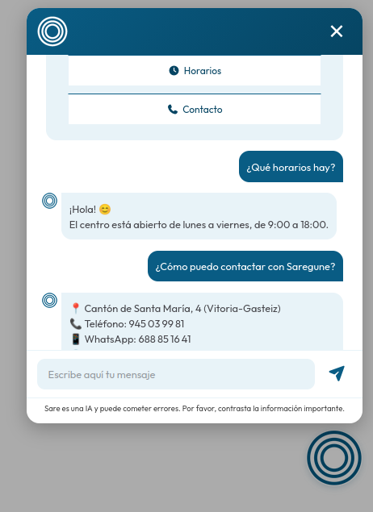
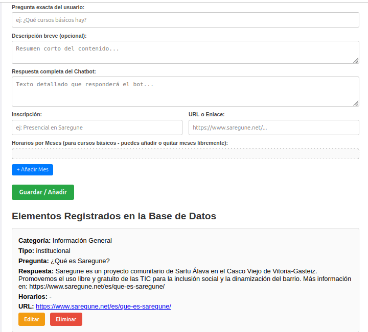

# Saregune Chatbot

## Descripción

Saregune Chatbot es una aplicación web desarrollada con Node.js, Express y MongoDB que permite interactuar con un asistente virtual para responder preguntas sobre la asociación Saregune, sus actividades y servicios.

El sistema incluye una interfaz pública y un **panel de administración protegido** desde el que se puede gestionar la base de conocimientos: crear, consultar, actualizar y eliminar información (CRUD).

## Tecnologías utilizadas

- **Entorno de ejecución:** Node.js
- **Framework backend:** Express.js
- **Base de datos:** MongoDB (controlador oficial `mongodb`)
- **Autenticación:** `express-basic-auth`
- **Configuración:** `dotenv`
- **Interfaz:** HTML5, CSS3 y JavaScript (ES6+)

## Funcionalidades

- **Chat interactivo público:** Respuestas contextualizadas basadas en la base de conocimientos.
- **Integración con IA:** Procesamiento de consultas a través del proveedor Groq.
- **Panel de Administración (`/admin`):**
    - Protección de acceso mediante autenticación HTTP Basic (usuario y contraseña).
    - Gestión completa (_CRUD_) de cursos y actividades.
    - Generación/selección dinámica de meses y fechas.
- **Datos iniciales:** Script `seed.js` para cargar información inicial en la base de datos.

## Estructura del proyecto

```bash
saregune-chatbot/
├── index.js
├── seed.js
├── package.json
├── package-lock.json
├── .gitignore
├── README.md
├── docs/
│   ├── chat-preview.png
│   └── admin-preview.png
├── public/
│   ├── assets/
│   │   ├── circulos.png
│   │   ├── circulosblanco.png
│   │   ├── logo_saregune_horizontal_2500.png
│   │   ├── logo_saregune_principal_negro.png
│   │   ├── logo_saregune_principal.png
│   │   └── s.png
│   ├── admin.css
│   ├── admin.html
│   ├── admin.js
│   ├── front.js
│   ├── index.html
│   └── styles.css
└── src/
    ├── config/
    │   └── db.js
    ├── controllers/
    │   ├── chatController.js
    │   └── conocimientosController.js
    ├── models/
    │   └── conocimiento.js
    ├── routes/
    │   ├── chatRoutes.js
    │   └── conocimientosRoutes.js
    └── services/
        └── ia.js

```

El archivo `.env` se crea localmente y está excluido del repositorio mediante `.gitignore`.

## Requisitos previos

- **Node.js** (versión 18 o superior)
- Una instancia local o remota de **MongoDB**

## Variables de entorno

Crea un archivo `.env` en la raíz del proyecto con la siguiente estructura:

```env
PORT=3000
MONGODB_URI=tu_conexion_mongodb
AI_API_KEY=tu_clave_api_groq
ADMIN_PASSWORD=tu_contraseña_para_el_panel_admin

```

## Instalación y ejecución

1. Clona el repositorio y accede al directorio del proyecto:

```bash
cd saregune-chatbot
```

2. Instala las dependencias:

```bash
npm install
```

3. Crea el archivo `.env` en la raíz del proyecto con las variables indicadas arriba.

4. (Opcional) Carga la base de datos con información inicial:

```bash
node seed.js
```

5. Inicia el servidor:

```bash
node index.js
```

## Uso

- **Chat público:** Accede a `http://localhost:3000/`.
- **Panel de administración:** Accede a `http://localhost:3000/admin`.
- **Usuario del panel:** `admin`.
- **Contraseña:** La que hayas definido en `ADMIN_PASSWORD` dentro del archivo `.env`.

## Capturas de Pantalla

### Interfaz Pública (Chatbot)



### Panel de Administración (Gestión de Conocimientos)



## Licencia

Este proyecto se distribuye bajo la licencia ISC, según se indica en `package.json`.
